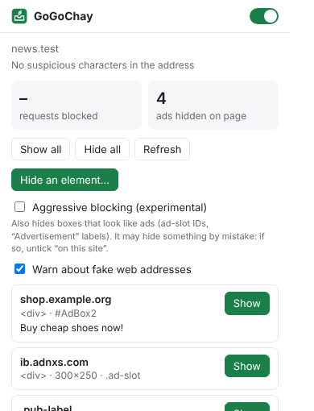
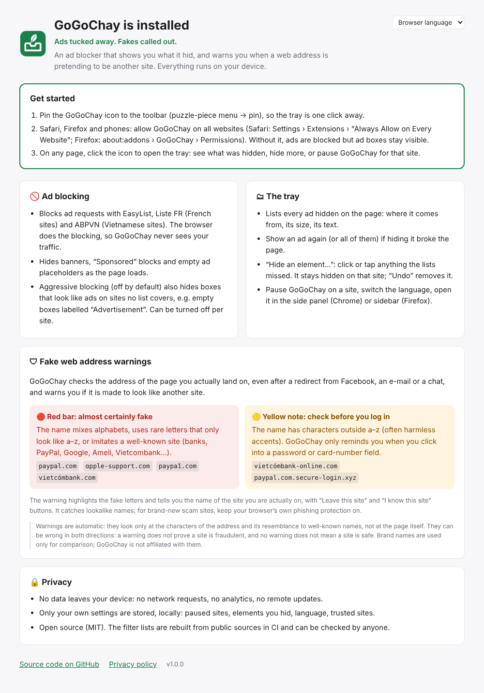

# GoGoChay

> **Ads tucked away. Fakes called out.** · *Quảng cáo cất vào khay, tên giả lộ mặt.* · *Les pubs ? Rangées. Les faux sites ? Démasqués.*

**Open-source ad blocker and fake-address detector for Chrome, Firefox (desktop & Android) and Safari. Hidden ads are collected into a tray instead of disappearing. No data collection, no network access.**



*(Tiếng Việt bên dưới · Français plus bas)*

**Why "GoGoChay"?** It's a Vietnamese pun: *chay* means **vegetarian**, so your browser goes on a clean diet with no fatty ads, and *chạy* means **run**, so ads and impostor sites run away. *Go go!* (Formerly "Ad Tray".)

## Features

### 🚫 Ad blocking
| | |
|---|---|
| **Blocks ad requests** | ~6,600 rules from **EasyList** (international), **Liste FR** (French sites) and **ABPVN** (Vietnamese sites), e.g. Google Ads, Taboola, Outbrain, Teads. The browser itself does the blocking; GoGoChay never sees your traffic. |
| **Hides ad boxes** | ~15,000 general rules + rules for ~8,000 specific sites hide banners, sponsored blocks and empty ad placeholders, without a flash on page load. |
| **Aggressive blocking** *(off by default)* | Also hides boxes that *look* like ads on sites no list covers: ad-slot IDs, and empty boxes labelled "Advertisement", "Publicité" or "Quảng cáo", even when the label is drawn with CSS. Can be switched off for one site. |

### 🗂 The tray
| | |
|---|---|
| **See what was hidden** | The toolbar popup, or Chrome's side panel or Firefox's sidebar, lists every ad hidden on the page: where it comes from, its size and its text. |
| **Show / hide again** | Bring back one ad (or all) if hiding it broke the page. The page scrolls to it and outlines it. |
| **Hide an element…** | Something slipped through? Click (or tap, on a phone) the element to hide it on that site from now on. ↑ selects the bigger box, Undo removes your rules. |
| **Pause on this site** | One switch turns GoGoChay off for a site you want to support or that misbehaves. |
| **3 languages** | Follows the browser's language: a French browser (fr, fr-CA, fr-BE, fr-CH…) gets French, a Vietnamese one Vietnamese, any other language English. You can override it in the tray; the features page and the in-page warnings use the same choice. |

### 🛡 Fake web address warnings *(on by default)*
Checks the address of the page you **actually land on**, after any redirects (for example a link clicked in Facebook, an e-mail or a chat), entirely offline.

| Level | When | Examples |
|---|---|---|
| 🔴 **Red bar**, almost certainly fake | the name mixes alphabets · is written in another alphabet that mimics Latin · uses rare letters that only look like a–z · imitates one of ~100 well-known sites (banks, PayPal, Google, Ameli, Vietcombank…) | `pаypal.com` (Cyrillic "а"), `аррӏе.com`, `ɑpple-support.com`, `paypa1.com`, `rnicrosoft.com`, `vietcómbank.com` |
| 🟡 **Yellow note**, check before you log in | the name has characters outside a–z that are often legitimate (accents), and you click into a **password or card-number field** · a well-known domain used as a decoy prefix | `vietcómbank-online.com`, `café.fr`, `paypal.com.secure-login.xyz` |
| *(nothing)* | plain a–z names, or sites you marked "I know this site" | `vietcombank.com.vn`, `bfmtv.com` |

The bar highlights the fake letters and states the name of the site you are actually on, with **Leave this site** and **I know this site** buttons. Pages can't read or click it (closed shadow DOM).

After install, GoGoChay opens a short **features page** (also reachable from the tray's "Features" link):



### 🔒 Privacy & trust
* **No network requests** at all, no telemetry, no remote updates, no remote code. Enforced by the extension's CSP and checked by `npm run verify` in CI.
* **Minimal permissions**, each explained below. Only your own settings are stored, on your device.
* **Reproducible lists**: the filter data is rebuilt in CI from pinned commits of each list and must match the repo.
* About 1,000 lines of hand-written JavaScript, small enough to read and audit.

### ⚖️ About the warnings
Address warnings are **automatic** and **heuristic**: GoGoChay looks only at the characters of the address and its resemblance to a built-in list of well-known names, never at the page content or any reputation database. They **can be wrong in both directions**: a warning does not prove that a site is fraudulent, and **the absence of a warning does not mean a site is safe**. Keep your browser's own phishing protection on. Brand names (PayPal, Google, Vietcombank, Ameli…) are used only for comparison; GoGoChay is not affiliated with or endorsed by their owners. The software is provided "as is", without warranty (see [LICENSE](LICENSE)).

## Why another ad blocker?

Ad blockers see every page you visit, so you have to trust them. GoGoChay is built so you don't need to trust its author. You can check it yourself:

| What it does NOT do | How you can check |
|---|---|
| No network requests, ever. No telemetry, no analytics, no remote list updates. | CSP `connect-src 'self'` in `manifest.json`; `scripts/verify.mjs` fails the build on `fetch`/XHR/WebSocket/beacon |
| No remote or dynamic code (`eval`, remote scripts, `import()`). | CSP `script-src 'self'` + `verify.mjs` |
| No access to cookies, history, downloads, or request contents. | `permissions` in `manifest.json`, allow-listed in `verify.mjs` |
| Doesn't store which pages you visit. The only things stored are what *you* set: paused sites, elements you hid, tray language, aggressive-mode setting, address-warning setting and the addresses you marked as trusted. | `chrome.storage.local` keys `paused`, `custom`, `lang`, `aggressive`, `domainCheck`, `trustedHosts`, nothing else |
| No hidden list changes. The filter data comes from each list's GitHub repo at a pinned commit, and CI rebuilds it and fails if the committed files differ. | `lists.config.json`, `.github/workflows/build.yml` |

### Permissions, explained

| Permission | Why |
|---|---|
| `declarativeNetRequest` | Lets the **browser** block ad requests using a static rule list. The extension never sees the requests. |
| `storage` | Remembers your settings: paused sites, elements you hid, tray language, aggressive mode, address warnings and trusted sites. |
| `activeTab` | Shows the "requests blocked" count for the tab you clicked on. No install warning. |
| `sidePanel` | Chrome only: lets the tray open in the side panel. |
| content script on `http(s)://*/*` | Needed to hide ad elements, list them in the tray, and check the page's address for fakes. This is why the store shows "read and change data on websites". The script sends nothing anywhere; it only talks to GoGoChay's own tray. ([source](extension/content.js)) |

The hand-written code is [`background.js`](extension/background.js), [`content.js`](extension/content.js), [`domain-check.js`](extension/domain-check.js), [`tray/`](extension/tray) and [`welcome/`](extension/welcome). Everything else is generated data.

## Install (from source)

### Chrome / Edge / Brave
1. Download `gogochay-chrome.zip` from Releases (or build it, see below) and unzip it.
2. Open `chrome://extensions`, turn on **Developer mode**, then click **Load unpacked** and pick the `extension` folder.

### Firefox (128+)

```bash
npm run build:firefox        # → dist/firefox/ and dist/gogochay-firefox.zip
```
* **To try it:** open `about:debugging#/runtime/this-firefox`, click **Load Temporary Add-on…**, and pick `dist/firefox/manifest.json`. It stays until Firefox restarts. CI also builds `gogochay-firefox.zip` (Actions › latest run › Artifacts).
* **Give it access to sites:** in `about:addons` › GoGoChay › **Permissions**, allow *Access your data for all websites*. Without this, Firefox blocks requests but can't hide ad boxes, and the tray stays empty.
* The tray opens in the toolbar popup or in the **Firefox sidebar** ("Open in side panel"). Firefox doesn't expose the blocked-request count, so that number shows "–".
* **Permanent install / publishing:** Firefox only installs signed add-ons. Sign it for free on addons.mozilla.org, either listed in the store or *unlisted* for self-distribution (`web-ext sign`).

### On phones

| Browser | Works? | How |
|---|---|---|
| **Firefox for Android** | ✅ same add-on as desktop Firefox (declared for Android) | For your own testing, plug in the phone with USB debugging on and run `npx web-ext run -t firefox-android --android-device <id> --source-dir dist/firefox`. For everyone else: publish on addons.mozilla.org, then install it from there in Firefox for Android. |
| **Vivaldi for Android** | ✅ runs Chrome Web Store extensions, so the Chrome build works | Install from the Chrome Web Store once GoGoChay is published there. |
| **Chrome for Android** | ❌ Google doesn't allow extensions in the phone app | Use Firefox or Vivaldi. |
| **Safari on iPhone/iPad** | possible (Safari Web Extensions run on iOS) | Needs an iOS build distributed through TestFlight / the App Store (Apple Developer Program). |

On a phone, the tray opens full width, and "Hide an element…" works by touch: tap to select, tap again or press ✓ to hide, ↑ to take the bigger box. **Tip:** the Facebook/Messenger apps open links in their own built-in browser, where no extension runs. Turn on "Links open externally" in the app's settings, or use "Open in browser", so links open in Firefox and GoGoChay can check the address.

### Safari (macOS)

**Without Xcode:** each push builds the Safari app on GitHub Actions.
1. Open the repo's **Actions** tab, then the latest *build* run, and download the **gogochay-safari** artifact.
2. Unzip it, then:
   ```bash
   xattr -dr com.apple.quarantine "GoGoChay.app"   # it was downloaded, unsigned
   mv "GoGoChay.app" /Applications/ && open "/Applications/GoGoChay.app"
   ```
3. Safari › Settings › Advanced › tick *Show features for web developers*, then Safari › Settings › **Developer** › tick **Allow unsigned extensions** (Safari turns this off again each time it restarts).
4. Safari › Settings › **Extensions** › enable **GoGoChay** and set it to **Always Allow on Every Website**. Without this, Safari blocks requests but doesn't hide ads, and the tray stays empty.

**With Xcode:** `./scripts/build-safari.sh`, then open `safari/GoGoChay/GoGoChay.xcodeproj` and Run the *GoGoChay* scheme. Same steps 3–4 apply.

Requires Safari 17+. Safari has no side panel, so the tray opens as a popup only.

## Build & verify

```bash
npm install          # only dev dependency: puppeteer-core (for the e2e test)
npm test             # unit tests of the EasyList → DNR converter
npm run build:lists  # regenerate rules from the pinned list commits
npm run verify       # security self-check (permissions, CSP, forbidden APIs)
npm run test:e2e     # loads the extension in Chrome against a local fake site
npm run package      # → dist/gogochay-chrome.zip
npm run build:firefox  # → dist/firefox/ + dist/gogochay-firefox.zip
npm run lint:firefox   # Mozilla's add-on linter (must report 0 errors)
npm run update:lists # pin the latest commit of every list and regenerate
```

## How it works

```
EasyList, Liste FR, ABPVN      ┌─► rules/<list>.json   (one ruleset per list; network blocking, done by the browser)
(pinned commits)  ──► scripts/convert.mjs
                               └─► data/cosmetic.js    (CSS selectors to hide, all lists merged)
```

* **Network**: ~58,000 filters become ~6,600 declarativeNetRequest rules (rules that differ only by domain are merged into one `requestDomains` list). That's well under the 30,000 rules Chrome guarantees, and `verify.mjs` checks it. To add a list, add it to `lists.config.json` and run `npm run build:lists`.
* **Cosmetic**: ~15,000 generic selectors + site-specific selectors for ~8,000 sites, injected as one stylesheet at `document_start` so ads never flash. Invalid selectors are found and dropped automatically.
* **Tray**: when you open it, the content script lists the outermost hidden elements (source host, size, text) as plain text. Nothing is rendered as HTML.
* Filters that can't be translated faithfully (regex, `$csp`, `$redirect`, procedural `:has-text()`, scriptlets) are **skipped, never guessed**.

## Limitations

* YouTube and other video ads served from first-party domains need scriptlets. GoGoChay doesn't run any scriptlets on purpose (no code injection), so it won't block these.
* The fake-address check knows ~100 well-known site names (global, French, Vietnamese banks and services; see `extension/domain-check.js`). It catches lookalikes *of those names*, plus any name that mixes alphabets. A brand-new scam name that resembles nothing on the list (e.g. `secure-account-check.com`) isn't flagged: that's the job of the browser's own phishing protection (Safe Browsing), which GoGoChay doesn't replace.
* Lists only cover what their authors found. When something slips through, use "Hide an element…" and, if you like, report it upstream to the list (EasyList, Liste FR, ABPVN).
* List updates come with extension updates, not over the network. That's the point.

## Publishing

* **Chrome Web Store**: one-time $5 developer fee. Upload `dist/gogochay-chrome.zip`. Point the "single purpose" field to ad blocking and the privacy fields to "does not collect data".
* **Safari / Mac App Store**: needs the Apple Developer Program. Archive the Xcode project made by `build-safari.sh`.

---

## Tiếng Việt

**Vì sao tên là GoGoChay?** Vì trình duyệt được *ăn chay*: sạch sẽ, không còn "thịt mỡ" quảng cáo. Còn quảng cáo và trang giả thì phải *chạy*. Go go!

**GoGoChay** là extension mã nguồn mở cho Chrome, Firefox (máy tính và Android) và Safari, có hai nhiệm vụ: **chặn quảng cáo** và **cảnh báo địa chỉ trang giả mạo**. GoGoChay không thu thập dữ liệu và không gửi request mạng nào.

### Tính năng
**🚫 Chặn quảng cáo**
* Chặn request quảng cáo bằng khoảng 6.600 luật từ **EasyList** (quốc tế), **Liste FR** (trang Pháp) và **ABPVN** (trang Việt), ví dụ Google Ads, Taboola, Teads. Việc chặn do chính trình duyệt làm.
* Ẩn khung quảng cáo, banner, khối "Sponsored" và ô giữ chỗ rỗng ngay khi trang tải, không bị nháy.
* **Chặn mạnh** (mặc định tắt): ẩn thêm các khung *trông giống* quảng cáo trên những trang chưa có danh sách nào nhắm tới, ví dụ khung rỗng có nhãn "Quảng cáo", "Publicité", "Advertisement". Tắt riêng được cho từng trang.

**🗂 Khay quảng cáo**
* Xem danh sách quảng cáo đã bị ẩn trên trang (nguồn, kích thước, nội dung), trong popup, Side Panel của Chrome hoặc sidebar của Firefox.
* **Hiện lại** từng quảng cáo hoặc tất cả, nếu việc ẩn làm vỡ trang.
* **Ẩn thêm phần tử…**: bấm (hoặc chạm, trên điện thoại) vào phần còn sót để ẩn nó trên trang đó. "↑ Khung lớn hơn" để chọn khung bao ngoài, "Hoàn tác" để bỏ.
* **Tạm tắt** GoGoChay trên một trang.
* Ngôn ngữ **tự theo trình duyệt**: trình duyệt tiếng Pháp (kể cả fr-CA, fr-BE…) hiện tiếng Pháp, tiếng Việt hiện tiếng Việt, mọi ngôn ngữ khác hiện tiếng Anh. Đổi được trong khay.

**🛡 Cảnh báo địa chỉ giả mạo** (mặc định bật)
Kiểm tra địa chỉ của trang bạn **thực sự vào**, sau mọi lần chuyển hướng (link từ Facebook, email, Zalo…), và chạy hoàn toàn trên máy.
* 🔴 **Thanh đỏ**, gần như chắc chắn là giả: tên trộn nhiều bảng chữ cái (`pаypal.com` với chữ "а" Kirin), dùng chữ hiếm chỉ để trông giống a–z (`ɑpple-support.com`), hoặc nhái khoảng 100 trang quen (ngân hàng, PayPal, Google, Ameli, Vietcombank…), ví dụ `paypa1.com`, `vietcómbank.com`.
* 🟡 **Nhắc vàng**, kiểm tra trước khi đăng nhập: tên có ký tự ngoài a–z (thường là dấu, có thể hợp lệ). GoGoChay chỉ nhắc khi bạn **bấm vào ô mật khẩu hoặc số thẻ**. Kiểu `paypal.com.secure-login.xyz` cũng bị nhắc vàng.
* Thanh cảnh báo tô các chữ giả và ghi rõ **"Tên trang bạn đang truy cập là: …"**, kèm hai nút *Rời khỏi trang này* và *Tôi biết trang này*.
* ⚖️ **Lưu ý:** cảnh báo được đưa ra **tự động**, chỉ dựa trên ký tự trong địa chỉ và mức độ giống tên các trang quen, không xét nội dung trang. Cảnh báo **có thể sai**: có cảnh báo không chứng minh trang đó lừa đảo, và **không có cảnh báo cũng không có nghĩa là trang an toàn**. Tên các thương hiệu chỉ dùng để so sánh; GoGoChay không liên kết với các thương hiệu đó.

**🔒 Riêng tư và minh bạch**
* Không gửi gì ra ngoài, không cập nhật từ xa, không chạy code từ xa.
* Chỉ xin quyền tối thiểu, và chỉ lưu các cài đặt của bạn, trên máy bạn.
* Danh sách chặn được CI build lại từ commit cố định của từng danh sách, ai cũng kiểm tra được.

### Cài đặt
* **Chrome / Edge / Brave:** `chrome://extensions` → bật Developer mode → Load unpacked → chọn thư mục `extension`.
* **Firefox:** `npm run build:firefox` → `about:debugging` → Load Temporary Add-on → `dist/firefox/manifest.json`. Sau đó trong `about:addons`, cho phép truy cập mọi trang.
* **Safari (Mac):** tải artifact `gogochay-safari` trên tab Actions, xem mục Safari ở trên.
* **Điện thoại:** Firefox Android, Vivaldi Android, Orion (iPhone). Chrome trên điện thoại không hỗ trợ extension. Nhớ bật "Links open externally" trong app Facebook để link mở bằng trình duyệt có GoGoChay.

## Français

**GoGoChay** est une extension open source pour Chrome, Firefox (ordinateur et Android) et Safari, qui fait deux choses : **bloquer les publicités** et **avertir des adresses de sites usurpées**. Elle ne collecte aucune donnée et ne fait aucune requête réseau.

* 🚫 **Blocage des pubs** : EasyList, Liste FR et ABPVN, masquage des emplacements publicitaires, et **blocage renforcé** optionnel (blocs vides marqués « Publicité »).
* 🗂 **Plateau** : la liste des pubs masquées sur la page, à réafficher au besoin. **Masquer un élément…** à la souris ou au doigt, pause par site, interface en français, anglais et vietnamien.
* 🛡 **Fausses adresses** : 🔴 barre rouge pour les noms qui mélangent les alphabets, utilisent des lettres trompeuses ou imitent un site connu (`pаypal.com`, `paypa1.com`, `ameIi.fr`). 🟡 Rappel jaune avant de saisir un mot de passe sur une adresse contenant des caractères hors a–z. Le site réellement consulté est toujours indiqué.
* 🔒 **Confidentialité** : aucune donnée envoyée, permissions minimales, listes reproductibles.
* ⚖️ **Avertissement** : les alertes sont automatiques et fondées sur les caractères de l’adresse. Elles peuvent se tromper : une alerte ne prouve pas qu’un site est frauduleux, et l’absence d’alerte ne garantit pas qu’un site est sûr. GoGoChay n’est affilié à aucune des marques citées.

## License

Code: [MIT](LICENSE) © 2026 Thanh-Hung DOAN. Bundled filter data keeps its own licenses (EasyList, Liste FR: CC BY-SA 3.0; ABPVN: GPLv3). See [NOTICE](NOTICE).
